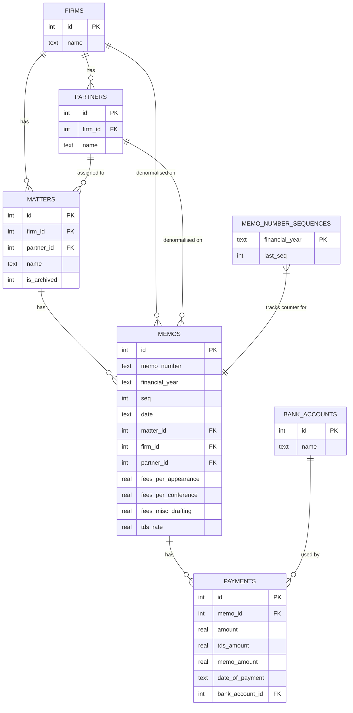

# Design Document — Fee Register

## Overview

The Fee Register is a single-user desktop application for a legal practitioner to raise and track legal invoices (Memos), manage Firms, Partners, and Matters in a three-level hierarchy, record payments, and produce Word/PDF exports from a user-supplied template. It also provides three report views (Feebook, Outstanding Memos, Statistics) and Excel-based backup/restore.

All data is stored locally on the practitioner's machine — there is no cloud sync, no authentication, and no multi-user access. The application must work offline without any external services.

### Key Design Goals

- **Local-first**: All data and files remain on-device; no network calls required for any core feature.
- **Template fidelity**: Word exports must preserve the user's `.docx` formatting exactly, replacing only tagged placeholders.
- **Financial-year awareness**: Memo numbering resets on 1 April each year; all report filters default to the current financial year.
- **Indian-English currency words**: Total Fees in Words uses the lakh/crore numbering system (e.g. "Rupees One Lakh Twenty Thousand Only").
- **Full data portability**: All application data can be exported to Excel and re-imported without data loss.

---

## Architecture

### Recommended Tech Stack

| Layer | Choice | Rationale |
|---|---|---|
| Desktop shell | **Electron v30+** | Mature, cross-platform (macOS/Windows), ships a consistent Chromium renderer. Avoids the Rust/system-WebView complexity of Tauri; the Node.js runtime is required anyway for `better-sqlite3`, `docxtemplater`, and `libreoffice-convert`. |
| Frontend framework | **React 18 + TypeScript** | Component model maps naturally to the multi-tab, filterable list UI. TypeScript catches field-mapping bugs at compile time. |
| Build tooling | **Vite + electron-vite** | Fast HMR in development; produces optimised Electron bundles. |
| Local database | **SQLite via better-sqlite3** | Synchronous API keeps IPC simple (no async waterfall for every query). A single `.db` file is easy to back up. Rebuilt for each Electron release with `electron-rebuild`. |
| ORM / query builder | **Drizzle ORM** | Type-safe schema definitions and query builder without the runtime overhead of Sequelize/TypeORM. Schema migrations handled via `drizzle-kit`. |
| Word export | **docxtemplater** | Populates `{{PLACEHOLDER}}` tags inside a user-uploaded `.docx` template without touching formatting. The free tier covers all required substitution patterns. |
| PDF export | **libreoffice-convert** (wrapping LibreOffice headless) | Converts the filled `.docx` to PDF locally. LibreOffice is the only freely available engine that faithfully renders complex `.docx` formatting. The user installs LibreOffice once; the app shells out to it. |
| Excel export/import | **ExcelJS** | Reads and writes `.xlsx` files with full column/style control; runs entirely in Node.js with no native bindings. |
| Indian number-to-words | Custom pure-TypeScript implementation | Converts a decimal fee amount to Indian-English words (crore/lakh system). A custom implementation is preferred over a third-party package so the exact output format ("Rupees … Only") can be controlled and property-tested. |
| State management | **Zustand** | Lightweight global store for UI state (active filters, selected records). Server/DB state managed via a thin IPC service layer. |
| UI component library | **shadcn/ui + Tailwind CSS** | Accessible, unstyled-by-default components (dialogs, dropdowns, tables) that can be styled to match a professional legal application aesthetic. |
| Testing | **Vitest + fast-check** | Vitest for unit/integration tests; fast-check for property-based tests. |

### Process Architecture

Electron's two-process model is used with strict separation:

```
┌─────────────────────────────────────────────────────────┐
│  Renderer Process  (Chromium)                           │
│  React UI · Zustand · shadcn/ui                         │
│  Communicates only via IPC (contextBridge)              │
└────────────────────┬────────────────────────────────────┘
                     │  ipcRenderer.invoke / ipcMain.handle
┌────────────────────▼────────────────────────────────────┐
│  Main Process  (Node.js)                                │
│  IPC Handlers · Service Layer · better-sqlite3          │
│  docxtemplater · libreoffice-convert · ExcelJS          │
└─────────────────────────────────────────────────────────┘
```

The renderer process has **no direct database or file-system access**. All such operations are routed through typed IPC channels exposed via `contextBridge`. This keeps the UI layer pure and independently testable.

### Directory Structure

```
fee-register/
├── electron/
│   ├── main.ts               # Electron entry, BrowserWindow setup
│   ├── preload.ts            # contextBridge API surface
│   └── ipc/
│       ├── firms.ts
│       ├── matters.ts
│       ├── memos.ts
│       ├── payments.ts
│       ├── feebook.ts
│       ├── export.ts
│       └── settings.ts
├── src/
│   ├── db/
│   │   ├── schema.ts         # Drizzle schema definitions
│   │   ├── migrations/       # drizzle-kit generated migrations
│   │   └── client.ts         # better-sqlite3 + Drizzle client singleton
│   ├── services/             # Pure business logic (no Electron deps)
│   │   ├── memoNumberService.ts
│   │   ├── feesInWordsService.ts
│   │   ├── exportService.ts
│   │   ├── backupService.ts
│   │   └── paymentService.ts
│   ├── components/
│   │   ├── firms/
│   │   ├── matters/
│   │   ├── memos/
│   │   ├── feebook/
│   │   ├── outstanding/
│   │   ├── statistics/
│   │   └── settings/
│   ├── stores/               # Zustand stores
│   └── App.tsx
├── tests/
│   ├── unit/
│   └── property/
└── vite.config.ts
```

---

## Components and Interfaces

### IPC API Surface (contextBridge)

The preload script exposes a typed `window.api` object. All methods return Promises and follow a consistent response envelope:

```typescript
type IPCResponse<T> =
  | { ok: true; data: T }
  | { ok: false; error: string; details?: unknown }
```

#### Firms

```typescript
firms.create(name: string): Promise<IPCResponse<Firm>>
firms.list(filter: 'all' | 'active' | 'archived'): Promise<IPCResponse<Firm[]>>
firms.get(id: number): Promise<IPCResponse<FirmDetail>>   // includes partners + matters
firms.update(id: number, data: Partial<FirmInput>): Promise<IPCResponse<Firm>>
firms.addPartner(firmId: number, name: string): Promise<IPCResponse<Partner>>
firms.removePartner(firmId: number, partnerId: number): Promise<IPCResponse<void>>
```

#### Matters

```typescript
matters.create(input: MatterInput): Promise<IPCResponse<Matter>>
matters.list(filter: MatterFilter): Promise<IPCResponse<Matter[]>>
matters.get(id: number): Promise<IPCResponse<MatterDetail>>  // includes memos
matters.archive(id: number): Promise<IPCResponse<Matter>>
matters.unarchive(id: number): Promise<IPCResponse<Matter>>
```

#### Memos

```typescript
memos.create(input: MemoInput): Promise<IPCResponse<Memo>>
memos.createBasedOn(sourceMemoId: number): Promise<IPCResponse<MemoFormData>>
memos.update(id: number, data: MemoInput): Promise<IPCResponse<Memo>>
memos.list(filter: MemoFilter): Promise<IPCResponse<MemoListItem[]>>
memos.get(id: number): Promise<IPCResponse<MemoDetail>>
memos.delete(id: number): Promise<IPCResponse<void>>
memos.exportWord(id: number): Promise<IPCResponse<void>>    // opens save dialog
memos.exportPDF(id: number): Promise<IPCResponse<void>>
memos.bulkExportExcel(filter: MemoFilter): Promise<IPCResponse<void>>
```

#### Payments

```typescript
payments.addToMemo(memoId: number, input: PaymentInput): Promise<IPCResponse<Payment>>
payments.update(id: number, data: PaymentInput): Promise<IPCResponse<Payment>>
payments.delete(id: number): Promise<IPCResponse<void>>
payments.listForMemo(memoId: number): Promise<IPCResponse<Payment[]>>
```

#### Feebook

```typescript
feebook.list(filter: FeebookFilter): Promise<IPCResponse<FeebookEntry[]>>
feebook.exportExcel(filter: FeebookFilter): Promise<IPCResponse<void>>
```

#### Outstanding Memos

```typescript
outstanding.list(filter: OutstandingFilter): Promise<IPCResponse<OutstandingEntry[]>>
outstanding.exportExcel(filter: OutstandingFilter): Promise<IPCResponse<void>>
```

#### Statistics

```typescript
statistics.get(breakdown: 'financialYear' | 'matter' | 'firm' | 'partner'): Promise<IPCResponse<StatisticsData>>
```

#### Settings

```typescript
settings.get(): Promise<IPCResponse<Settings>>
settings.update(data: Partial<SettingsInput>): Promise<IPCResponse<Settings>>
settings.uploadTemplate(filePath: string): Promise<IPCResponse<void>>
settings.addBankAccount(name: string): Promise<IPCResponse<BankAccount>>
settings.updateBankAccount(id: number, name: string): Promise<IPCResponse<BankAccount>>
settings.deleteBankAccount(id: number): Promise<IPCResponse<void>>
settings.restoreFromExcel(filePath: string): Promise<IPCResponse<RestoreResult>>
```

#### Backup

```typescript
backup.export(): Promise<IPCResponse<void>>   // opens save dialog, writes Excel
```

### Key TypeScript Types

```typescript
interface Firm {
  id: number
  name: string
  status: 'active' | 'archived'  // derived
}

interface Partner {
  id: number
  firmId: number
  name: string
}

interface Matter {
  id: number
  firmId: number
  partnerId: number
  name: string
  isArchived: boolean
}

interface Memo {
  id: number
  memoNumber: string              // "YYYY-YY/N"
  financialYear: string           // "YYYY-YY"
  seq: number
  date: string                    // ISO 8601
  matterId: number
  firmId: number
  partnerId: number
  addresseeLine1: string
  addresseeLine2: string
  courtName: string
  additionalDetailsLeft: string
  additionalDetailsRight: string
  plaintiffName: string
  plaintiffType: string
  defendantName: string
  defendantType: string
  client: string
  numAppearances: number
  datesOfAppearances: string
  feesPerAppearance: number
  numConferences: number
  datesOfConferences: string
  feesPerConference: number
  miscDraftingDescription: string
  feesMiscDrafting: number
  tdsRate: number
  // Computed fields (not stored in DB)
  feesAppearances: number         // numAppearances × feesPerAppearance
  feesConferences: number         // numConferences × feesPerConference
  totalFees: number               // feesAppearances + feesConferences + feesMiscDrafting
  totalFeesInWords: string        // Indian-English words
  lessTds: number                 // totalFees × (tdsRate / 100)
  amountPaid: number              // SUM(payments.amount)
  dateOfLastPayment: string | null
  status: 'Paid' | 'Unpaid'
}

interface Payment {
  id: number
  memoId: number | null           // null for unaccounted entries
  amount: number
  tdsAmount: number
  memoAmount: number
  dateOfPayment: string
  payee: string
  bankAccountId: number | null
  paymentDetails: string          // internal only, never exported
  paymentType: 'Full' | 'Partial' // derived
}

interface Settings {
  defaultFeesPerAppearance: number
  defaultFeesPerConference: number
  defaultFeesMiscDrafting: number
  defaultAdditionalDetailsLeft: string
  defaultAdditionalDetailsRight: string
  defaultTdsRate: number          // default 10
  wordTemplatePath: string | null
}

interface BankAccount {
  id: number
  name: string
}
```

### UI Component Hierarchy

```
App
├── TopNav (tabs: Memos | Feebook | Outstanding | Statistics | Settings)
│   └── BackupButton
├── FirmsPage
│   ├── FirmList (filter: All/Active/Archived, default Active)
│   │   └── FirmListRow → CreateMatterButton
│   └── FirmDetailPage
│       ├── FirmEditForm
│       └── MattersByPartner (filter: All/Active/Archived, default Active)
│           └── MatterRow → archive/unarchive
├── MemosPage
│   ├── MemoFilters (FinancialYear, Firm, Partner, Matter, SelectedMatters, UnpaidOnly)
│   ├── MemoList
│   │   └── MemoRow → Edit | MarkPayment | ExportWord | ExportPDF
│   └── BulkExportExcelButton
├── MemoForm (create / edit / based-on)
│   ├── CalculatedFieldsPanel (read-only: FeesAppearances, FeesConferences,
│   │   TotalFees, TotalFeesInWords, LessTDS)
│   └── SaveOptions (Save | Save & Export to Word | Save & Export to PDF)
├── PaymentModal
│   ├── PaymentSummary (total paid vs total fees)
│   └── PaymentList → add / edit / delete
├── FeebookPage
│   ├── FeebookFilters (FinancialYear, Firm, Partner, BankAccount, UnaccountedOnly)
│   ├── FeebookList
│   └── ExportExcelButton
├── OutstandingPage
│   ├── OutstandingFilters (Partner, Matter, SelectedMatters)
│   ├── OutstandingList (grouped by Matter, with total row)
│   └── ExportExcelButton
├── StatisticsPage
│   └── BreakdownSelector (FinancialYear | Matter | Firm | Partner)
└── SettingsPage
    ├── DefaultsForm
    ├── BankAccountManager
    └── TemplateUploader
```

---

## Data Models

### Database Schema (SQLite via Drizzle ORM)

#### `firms`

| Column | Type | Constraints | Notes |
|---|---|---|---|
| `id` | INTEGER | PK, AUTOINCREMENT | |
| `name` | TEXT | NOT NULL, UNIQUE | Firm display name |
| `created_at` | TEXT | NOT NULL | ISO 8601 |
| `updated_at` | TEXT | NOT NULL | ISO 8601 |

#### `partners`

| Column | Type | Constraints | Notes |
|---|---|---|---|
| `id` | INTEGER | PK, AUTOINCREMENT | |
| `firm_id` | INTEGER | NOT NULL, FK → firms.id | |
| `name` | TEXT | NOT NULL | Partner name within firm |
| `created_at` | TEXT | NOT NULL | |

Unique constraint: `(firm_id, name)`.

#### `matters`

| Column | Type | Constraints | Notes |
|---|---|---|---|
| `id` | INTEGER | PK, AUTOINCREMENT | |
| `firm_id` | INTEGER | NOT NULL, FK → firms.id | |
| `partner_id` | INTEGER | NOT NULL, FK → partners.id | |
| `name` | TEXT | NOT NULL | |
| `is_archived` | INTEGER | NOT NULL DEFAULT 0 | 0 = active, 1 = archived |
| `created_at` | TEXT | NOT NULL | |
| `updated_at` | TEXT | NOT NULL | |

Unique constraint: `(firm_id, name)`.

#### `memos`

| Column | Type | Constraints | Notes |
|---|---|---|---|
| `id` | INTEGER | PK, AUTOINCREMENT | |
| `memo_number` | TEXT | NOT NULL, UNIQUE | "YYYY-YY/N" |
| `financial_year` | TEXT | NOT NULL | "YYYY-YY" derived from date |
| `seq` | INTEGER | NOT NULL | Sequential counter within financial year |
| `date` | TEXT | NOT NULL | ISO 8601 date |
| `matter_id` | INTEGER | NOT NULL, FK → matters.id | |
| `firm_id` | INTEGER | NOT NULL, FK → firms.id | Denormalised for query performance |
| `partner_id` | INTEGER | NOT NULL, FK → partners.id | Denormalised |
| `addressee_line1` | TEXT | NOT NULL | Defaults to firm name |
| `addressee_line2` | TEXT | | Multi-line |
| `court_name` | TEXT | | Multi-line |
| `additional_details_left` | TEXT | | |
| `additional_details_right` | TEXT | | |
| `plaintiff_name` | TEXT | | |
| `plaintiff_type` | TEXT | | |
| `defendant_name` | TEXT | | |
| `defendant_type` | TEXT | | |
| `client` | TEXT | | |
| `num_appearances` | INTEGER | NOT NULL DEFAULT 0 | |
| `dates_of_appearances` | TEXT | | Free text |
| `fees_per_appearance` | REAL | NOT NULL DEFAULT 0 | |
| `num_conferences` | INTEGER | NOT NULL DEFAULT 0 | |
| `dates_of_conferences` | TEXT | | Free text |
| `fees_per_conference` | REAL | NOT NULL DEFAULT 0 | |
| `misc_drafting_description` | TEXT | | |
| `fees_misc_drafting` | REAL | NOT NULL DEFAULT 0 | |
| `tds_rate` | REAL | NOT NULL DEFAULT 10 | Percentage |
| `created_at` | TEXT | NOT NULL | |
| `updated_at` | TEXT | NOT NULL | |

**Computed fields** (derived at read time, never stored):

| Derived field | Formula |
|---|---|
| `fees_appearances` | `num_appearances × fees_per_appearance` |
| `fees_conferences` | `num_conferences × fees_per_conference` |
| `total_fees` | `fees_appearances + fees_conferences + fees_misc_drafting` |
| `total_fees_in_words` | `feesInWordsService.convert(total_fees)` |
| `less_tds` | `total_fees × (tds_rate / 100)` |
| `amount_paid` | `SUM(payments.amount)` for this memo |
| `date_of_last_payment` | `MAX(payments.date_of_payment)` for this memo |
| `status` | `'Paid'` if `amount_paid = total_fees` else `'Unpaid'` |

> Design decision: Computed monetary values are not stored to prevent drift. They are recalculated on every read. `total_fees` changes only when rate/count fields change; the recalculation is cheap and always correct.

#### `payments`

| Column | Type | Constraints | Notes |
|---|---|---|---|
| `id` | INTEGER | PK, AUTOINCREMENT | |
| `memo_id` | INTEGER | FK → memos.id (nullable) | NULL = unaccounted entry |
| `amount` | REAL | NOT NULL | |
| `tds_amount` | REAL | NOT NULL DEFAULT 0 | |
| `memo_amount` | REAL | NOT NULL DEFAULT 0 | |
| `date_of_payment` | TEXT | NOT NULL | ISO 8601 date |
| `payee` | TEXT | | |
| `bank_account_id` | INTEGER | FK → bank_accounts.id (nullable) | |
| `payment_details` | TEXT | | Internal note, never exported |
| `created_at` | TEXT | NOT NULL | |
| `updated_at` | TEXT | NOT NULL | |

**Derived field**: `payment_type` — `'Full'` if `SUM(all payments for memo) = total_fees`, else `'Partial'`.

#### `bank_accounts`

| Column | Type | Constraints | Notes |
|---|---|---|---|
| `id` | INTEGER | PK, AUTOINCREMENT | |
| `name` | TEXT | NOT NULL, UNIQUE | Display name |
| `created_at` | TEXT | NOT NULL | |

#### `settings`

Single-row table (enforced by `CHECK(id = 1)`).

| Column | Type | Constraints | Notes |
|---|---|---|---|
| `id` | INTEGER | PK, CHECK(id=1) | Always 1 |
| `default_fees_per_appearance` | REAL | NOT NULL DEFAULT 0 | |
| `default_fees_per_conference` | REAL | NOT NULL DEFAULT 0 | |
| `default_fees_misc_drafting` | REAL | NOT NULL DEFAULT 0 | |
| `default_additional_details_left` | TEXT | | |
| `default_additional_details_right` | TEXT | | |
| `default_tds_rate` | REAL | NOT NULL DEFAULT 10 | |
| `word_template_path` | TEXT | | Absolute path to stored `.docx` |
| `updated_at` | TEXT | NOT NULL | |

#### `memo_number_sequences`

Tracks the current counter per financial year. This table guarantees uniqueness and ensures deleted Memo numbers are never reused.

| Column | Type | Constraints | Notes |
|---|---|---|---|
| `financial_year` | TEXT | PK | "YYYY-YY" |
| `last_seq` | INTEGER | NOT NULL DEFAULT 0 | Monotonically increasing, never decremented |

### Entity Relationship Diagram



---

## Key Workflows

### 1. Memo Number Generation

Memo numbers must be unique, non-reused, and reset per financial year.

```
createMemo(memoInput):
  1. Derive financial year from memoInput.date:
       month >= 4 → `${year}-${(year+1).toString().slice(2)}`
       month < 4  → `${year-1}-${year.toString().slice(2)}`
       e.g. 2026-07-15 → "2026-27"
            2027-02-01 → "2026-27"

  2. BEGIN EXCLUSIVE TRANSACTION

  3. SELECT last_seq FROM memo_number_sequences WHERE financial_year = ?
     IF NOT FOUND: INSERT (financial_year, last_seq = 0)

  4. newSeq = last_seq + 1

  5. UPDATE memo_number_sequences SET last_seq = newSeq WHERE financial_year = ?

  6. memoNumber = `${financialYear}/${newSeq}`

  7. INSERT INTO memos (..., memo_number, financial_year, seq, ...)

  8. COMMIT
```

The exclusive transaction prevents duplicate sequence numbers. When a Memo is deleted, `last_seq` is **not** decremented — the next Memo for that financial year receives `last_seq + 1`, permanently skipping the deleted number.

### 2. Memo Creation Workflow

```
User clicks "New Memo" for a Matter
  → UI checks matter.is_archived
      IF archived: show error toast, do not proceed

  → Open MemoForm
      → Pre-fill from Settings (fees defaults, TDS rate, additional details)
      → Pre-fill addressee_line1 with firm.name
      → Reactively compute and display calculated fields as user types

  → User fills form and clicks a save option

  → Validate: date, matter_id, total_fees > 0 are required
      IF invalid: show field-level errors, do not save

  → Call memos.create(input) via IPC
      → Main process runs createMemo transaction
      → Returns saved Memo with generated memo_number

  → IF "Save & Export to Word": call memos.exportWord(id)
  → IF "Save & Export to PDF": call memos.exportPDF(id)
```

### 3. "Create Based On" Workflow

```
User clicks "Create Based On" on an existing Memo
  → Call memos.createBasedOn(sourceMemoId) via IPC
      → Fetch source Memo from DB
      → Return MemoFormData:
          · All non-payment, non-calculated fields copied from source
          · memo_number = "" (generated on save)
          · date = "" (user must enter)
          · Lines 27–30 (payment fields) cleared

  → Open MemoForm pre-filled with returned MemoFormData
  → User enters date and reviews fields
  → Save proceeds as normal Memo creation
```

### 4. Export Pipeline

#### Word Export

```
exportWord(memoId):
  1. Fetch full Memo data including all computed fields

  2. Check settings.word_template_path
     IF null: return { error: "NO_TEMPLATE" }

  3. Load template .docx binary (fs.readFileSync)

  4. Build placeholder map:
     {
       LINE_1_DATE:               formatDate(memo.date),
       LINE_2_MEMO_NUMBER:        memo.memo_number,
       LINE_5_ADDRESSEE_1:        memo.addressee_line1,
       LINE_6_ADDRESSEE_2:        memo.addressee_line2,
       LINE_7_MATTER_NAME:        memo.matter_name,
       LINE_8_COURT_NAME:         memo.court_name,
       LINE_9_ADD_LEFT:           memo.additional_details_left,
       LINE_10_ADD_RIGHT:         memo.additional_details_right,
       LINE_11_PLAINTIFF:         memo.plaintiff_name,
       LINE_12_PLAINTIFF_TYPE:    memo.plaintiff_type,
       LINE_13_DEFENDANT:         memo.defendant_name,
       LINE_14_DEFENDANT_TYPE:    memo.defendant_type,
       LINE_15_CLIENT:            memo.client,
       LINE_16_NUM_APPEARANCES:   String(memo.num_appearances),
       LINE_17_DATES_APPEARANCES: memo.dates_of_appearances,
       LINE_18_FEES_PER_APP:      formatCurrency(memo.fees_per_appearance),
       LINE_18A_FEES_APPEARANCES: formatCurrency(computed.fees_appearances),
       LINE_19_NUM_CONFERENCES:   String(memo.num_conferences),
       LINE_20_DATES_CONFERENCES: memo.dates_of_conferences,
       LINE_21_FEES_PER_CONF:     formatCurrency(memo.fees_per_conference),
       LINE_21A_FEES_CONFERENCES: formatCurrency(computed.fees_conferences),
       LINE_22_MISC_DESC:         memo.misc_drafting_description,
       LINE_23_FEES_MISC:         formatCurrency(memo.fees_misc_drafting),
       LINE_24_TOTAL_FEES:        formatCurrency(computed.total_fees),
       LINE_24A_TOTAL_FEES_WORDS: computed.total_fees_in_words,
     }
     // Internal fields (LINE_3 Firm, LINE_4 Partner, Lines 25–30)
     // are deliberately excluded; blank placeholders are nulled out
     // by docxtemplater's nullGetter

  5. Configure docxtemplater:
     - paragraphLoop: true
     - nullGetter: () => ""
     - A post-render pass removes any paragraph that resolves
       entirely to empty string (Requirement 9.4: no blank lines)

  6. Generate .docx buffer via doc.getZip().generate({ type: "nodebuffer" })

  7. Derive filename:
     seqN = memo.memo_number.split("/")[1]
     filename = `Memo No ${seqN} of Ziyad Madon (${memo.matter_name}).docx`

  8. Open Electron save dialog with suggested filename
  9. Write buffer to chosen path
```

#### PDF Export

```
exportPDF(memoId):
  1. Execute exportWord steps 1–6 to produce a .docx buffer
  2. Write buffer to a temp file in os.tmpdir()
  3. Call libreoffice-convert:
       convert(docxBuffer, '.pdf', undefined)
  4. Clean up temp file
  5. Derive filename (same format, .pdf extension)
  6. Open Electron save dialog
  7. Write PDF buffer to chosen path
```

> **LibreOffice dependency**: On first launch, the app checks for a LibreOffice executable and displays a one-time setup notice if it is not found.

### 5. Payment Recording Workflow

```
User clicks "Mark Payment" on a Memo row
  → Open PaymentModal for that Memo
      → Load existing payments via payments.listForMemo(memoId)
      → Display summary: amount paid vs total fees

  → User adds / edits / deletes payments
      → Each operation persists immediately via IPC
      → Summary recalculates after each change

  → On modal close: Memo list row refreshes to show updated
    amount_paid, date_of_last_payment, and status
```

### 6. Backup and Restore

#### Backup (Export to Excel)

```
backup.export():
  1. Open Electron save dialog for .xlsx
  2. Query all data:
       firms, partners, matters, memos (all stored fields),
       payments, bank_accounts, settings
  3. Build ExcelJS workbook with sheets:
       "Firms", "Partners", "Matters", "Memos",
       "Payments", "BankAccounts", "Settings"
  4. Each sheet has a header row matching column names
  5. Write workbook to chosen path
```

#### Restore (Import from Excel)

```
settings.restoreFromExcel(filePath):
  1. Prompt user for confirmation: "This replaces all data. Cannot be undone."
  2. Read Excel file with ExcelJS
  3. Validate: required sheets and columns exist
  4. BEGIN TRANSACTION
  5. Truncate all tables in dependency order:
       payments → memos → matters → partners → firms
       bank_accounts, memo_number_sequences, settings
  6. Re-insert rows from each sheet in dependency order
  7. Recompute memo_number_sequences from the imported memos data
  8. COMMIT
  9. Return RestoreResult { rowsImported, warnings[] }
```

### 7. Indian Number-to-Words Conversion

A custom pure-TypeScript service (`feesInWordsService.ts`) converts a non-negative decimal to Indian-English words.

```
feesInWords(amount: number): string

Examples:
  120000        → "Rupees One Lakh Twenty Thousand Only"
  10000000.50   → "Rupees One Crore and Fifty Paise Only"
  0             → "Rupees Zero Only"
```

The service handles: crores, lakhs, thousands, hundreds, tens, units, and paise. Output is always prefixed with "Rupees" and suffixed with "Only".

---

## Error Handling

| Scenario | Handling |
|---|---|
| Duplicate Firm name | DB UNIQUE constraint → `{ error: "DUPLICATE_FIRM_NAME" }` → UI shows inline field error |
| Duplicate Matter name within Firm | Same pattern |
| Memo saved with missing required fields | Validated in service layer before DB insert; returns array of missing field names |
| Archived Matter — new Memo attempt | Service checks `matter.is_archived`; returns `{ error: "MATTER_ARCHIVED" }` |
| Word export with no template | Service checks `settings.word_template_path`; returns `{ error: "NO_TEMPLATE" }` → UI directs user to Settings |
| LibreOffice not found for PDF | `libreoffice-convert` throws; caught and returned as `{ error: "LIBREOFFICE_NOT_FOUND" }` → UI shows setup guidance |
| Restore from invalid Excel | ExcelJS parse errors caught; missing sheets/columns returned as validation errors with sheet and column names |
| SQLite transaction failure | Rolled back; error surfaced to IPC caller; UI shows error toast |
| Memo number sequence race | Exclusive transaction on `memo_number_sequences` prevents duplicates |

---

## Correctness Properties

*A property is a characteristic or behavior that should hold true across all valid executions of a system — essentially, a formal statement about what the system should do. Properties serve as the bridge between human-readable specifications and machine-verifiable correctness guarantees.*

---

### Property 1: Firm names are unique

*For any* two attempts to create Firms with the same name, the second attempt SHALL be rejected and only one Firm with that name SHALL exist in the database.

**Validates: Requirements 1.1**

---

### Property 2: Firm active/archived classification matches its Matters

*For any* Firm and *any* arbitrary set of associated Matters with arbitrary active/archived statuses, the Firm's derived classification SHALL be "Active" if and only if at least one of its Matters is Active, and "Archived" if and only if all of its Matters are Archived (or there are no Matters).

**Validates: Requirements 1.3**

---

### Property 3: Firms list is always alphabetically sorted

*For any* set of Firms created in any order, the list returned by the Firms query SHALL be sorted alphabetically by Firm name (case-insensitive), regardless of insertion order.

**Validates: Requirements 1.4**

---

### Property 4: Matters within a Partner are always alphabetically sorted

*For any* Firm with Matters belonging to multiple Partners, the Matters under each Partner SHALL be sorted alphabetically by Matter name (case-insensitive) within that Partner group, regardless of creation order.

**Validates: Requirements 1.8**

---

### Property 5: New Matters always start as Active

*For any* valid Matter creation input, the resulting Matter SHALL have `is_archived = false` immediately after creation, regardless of the input values supplied.

**Validates: Requirements 2.2**

---

### Property 6: Archive → Unarchive is a round-trip for Matter status

*For any* Active Matter, archiving it and then immediately unarchiving it SHALL restore the Matter to Active status, leaving all other Matter fields (name, firm, partner) unchanged.

**Validates: Requirements 2.3, 2.4**

---

### Property 7: Archived Matters reject all Memo creation attempts

*For any* Archived Matter and *any* valid Memo input, the attempt to create a Memo against that Matter SHALL be rejected with an error, and no Memo SHALL be persisted.

**Validates: Requirements 2.7**

---

### Property 8: Memo number format and financial year boundary are correct for any date

*For any* valid date supplied as the Memo Date, the auto-generated Memo Number SHALL:
- Match the pattern `^\d{4}-\d{2}\/\d+$`
- Have a financial-year portion that correctly reflects the April–March boundary (dates 1 April–31 March of the following year share the same financial year)
- Have the correct financial year at the boundary dates: 31 March and 1 April of the same calendar year SHALL produce different financial years

**Validates: Requirements 3.1, 3.2**

---

### Property 9: Sequential counter starts at 1 for each new financial year

*For any* financial year in which no prior Memos exist, the first Memo created SHALL receive sequence number 1 (producing a Memo Number ending in `/1`).

**Validates: Requirements 3.3**

---

### Property 10: All Memo numbers across any sequence of creations are pairwise distinct

*For any* sequence of N Memo creations (across the same or different financial years), all N resulting Memo Numbers SHALL be pairwise distinct.

**Validates: Requirements 3.4**

---

### Property 11: Deleted Memo numbers are never reused

*For any* Memo that is deleted, all subsequently created Memos in the same financial year SHALL receive a sequence number strictly greater than the deleted Memo's sequence number.

**Validates: Requirements 3.5**

---

### Property 12: Fee line item amounts equal count × rate

*For any* non-negative integer count (number of appearances or conferences) and *any* non-negative decimal rate (fees per unit), the computed fee line amount SHALL equal exactly `count × rate`. This holds independently for appearance fees and conference fees.

**Validates: Requirements 4.3, 4.4**

---

### Property 13: Total Fees equals the sum of all three fee components

*For any* non-negative values of `fees_appearances`, `fees_conferences`, and `fees_misc_drafting`, the computed `total_fees` SHALL equal `fees_appearances + fees_conferences + fees_misc_drafting`.

**Validates: Requirements 4.5**

---

### Property 14: Fees in Words always starts with "Rupees" and ends with "Only"

*For any* non-negative decimal amount, the `feesInWords` output SHALL be a non-empty string that begins with the word "Rupees" and ends with the word "Only".

**Validates: Requirements 4.6**

---

### Property 15: Less TDS equals total fees × rate / 100

*For any* `total_fees ≥ 0` and *any* `tds_rate` in the range [0, 100], the computed `less_tds` SHALL equal `total_fees × (tds_rate / 100)`.

**Validates: Requirements 4.7**

---

### Property 16: New Memo form pre-fills match current Settings values

*For any* Settings state, opening a new Memo form SHALL produce a form whose pre-filled defaults (fees per appearance, fees per conference, fees misc/drafting, additional details left, additional details right, TDS rate) exactly match the values stored in Settings at the time of opening.

**Validates: Requirements 4.9**

---

### Property 17: Memo save is rejected when any required field is absent

*For any* Memo input where at least one of `date`, `matter_id`, or `total_fees` is absent or zero, the save operation SHALL return a validation error identifying the missing field(s) and SHALL NOT persist any Memo to the database.

**Validates: Requirements 4.10, 4.11**

---

### Property 18: "Create Based On" preserves non-payment non-calculated fields and clears the rest

*For any* saved Memo M, calling `createBasedOn(M)` SHALL return a `MemoFormData` where:
- Every non-payment, non-calculated field equals the corresponding field in M
- `memo_number` is blank
- `date` is blank
- All payment fields (Lines 27–30) are cleared/empty

**Validates: Requirements 5.1, 5.2, 5.3**

---

### Property 19: Payment aggregate determines Memo status and payment type simultaneously

*For any* Memo with a given `total_fees` and *any* non-empty collection of associated payment amounts, the following invariants SHALL hold simultaneously:
- `status = 'Paid'` if and only if `SUM(payments.amount) = total_fees`; otherwise `'Unpaid'`
- Each payment's `payment_type = 'Full'` if and only if `SUM(all payments for that Memo) = total_fees`; otherwise `'Partial'`

**Validates: Requirements 7.2, 10.8**

---

### Property 20: Export filename matches the required format for any Memo

*For any* Memo with sequential number N (the numeric portion after `/` in the Memo Number) and matter name M, the export filename SHALL equal exactly `"Memo No {N} of Ziyad Madon ({M}).docx"` for Word exports and `"Memo No {N} of Ziyad Madon ({M}).pdf"` for PDF exports.

**Validates: Requirements 9.3**

---

### Property 21: Statistics aggregates equal the sum of individual Memo values

*For any* set of Memos within a given scope (financial year, firm, matter, or partner), the computed statistics SHALL satisfy:
- `totalBilled = SUM(memo.total_fees)` for all Memos in scope
- `totalReceived = SUM(memo.amount_paid)` for all Memos in scope

**Validates: Requirements 12.1**

---

### Property 22: Backup round-trip preserves all data

*For any* application state, exporting to Excel and then restoring from that Excel file SHALL produce a database state that is functionally equivalent to the original: all Firms, Partners, Matters, Memos, Payments, Bank Accounts, and Settings SHALL have the same field values as before the backup.

**Validates: Requirements 14.2, 14.3**

---

## Testing Strategy

### Dual Testing Approach

Unit tests and property-based tests are complementary:
- **Unit tests** cover specific examples, integration points, edge cases, and error conditions
- **Property-based tests** verify universal properties across randomly generated inputs (minimum 100 iterations per property)

### Unit Tests (Vitest)

- `memoNumberService`: financial year derivation, sequence increment, boundary dates (31 March / 1 April), format output
- `feesInWordsService`: known amounts (0, round numbers, lakhs, crores, paise)
- Computed field calculations (fees_appearances, fees_conferences, total_fees, less_tds)
- Filter logic for Memos, Feebook, Outstanding views
- Payment status derivation (Paid vs Unpaid, Full vs Partial)
- Export filename generation
- Validation logic (missing required fields)

### Integration Tests (Vitest + in-memory SQLite)

- Full Memo creation with number generation (including cross-year boundary)
- Cascade behavior on Matter archive/unarchive
- Payment aggregation queries
- Backup round-trip (export then restore produces identical data)
- Filter queries for Memos, Feebook, and Outstanding views

### Property-Based Tests (Vitest + fast-check)

Each correctness property above is implemented as a single property-based test using [fast-check](https://fast-check.dev/), configured with a minimum of 100 iterations. Each test is tagged with a comment referencing its design property:

```typescript
// Feature: fee-register, Property N: <property_text>
```

fast-check is chosen because it is a mature, well-documented TypeScript-native PBT library with excellent shrinking support.

### Manual / Smoke Tests

- Template upload and Word export with a real `.docx` file
- PDF export via LibreOffice (requires LibreOffice installed)
- Excel backup and restore round-trip
- Cross-platform rendering on macOS and Windows

### Runtime Environment Requirement (Node.js version)

The application depends on `better-sqlite3`, a native (C++) Node addon. The
test runner must use a `better-sqlite3` version whose native binding supports
the running Node.js version.

Earlier development used `better-sqlite3@11`, which predates Node.js 24 support.
On Node 24 its native garbage-collection finalizers could abort the Vitest
worker during teardown with `Assertion failed: (env) != nullptr` in
`node::RemoveEnvironmentCleanupHook`. All test assertions passed; the abort was
a teardown-only artifact, not an application defect.

Resolution:

- The project uses **`better-sqlite3@13`** (`engines: node >=22`, with explicit
  Node 24 support). This removes the teardown abort entirely — the full suite
  runs clean and deterministic on Node.js **20, 22, and 24**.
- Minimum supported Node.js is **20** (`engines` field in `package.json`:
  `">=20"`). No specific Node pin is required.
- After changing the Node major version, run `npm rebuild better-sqlite3` so the
  native binding matches the active ABI.
- The Vitest configuration runs the suite in a single run with the `threads`
  pool, a single thread, and sequential files — a stable configuration for the
  native SQLite addon.
- `scripts/run-tests.mjs` remains available as an optional per-file runner (one
  child process per test file) for diagnostics.
